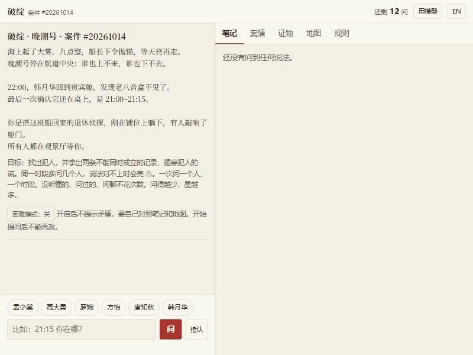

# 破绽 / Loose Thread

一款中英双语的推理游戏：用自己的话审问嫌疑人，从证词的破绽里找出犯人。
A bilingual deduction game: question suspects in your own words, and find the culprit through the loose threads in their testimony.

**[▶ 在浏览器里玩 / Play in your browser](https://jiachengwu591.github.io/loosethread/)** · [itch.io](https://jiachengwu591.itch.io/loosethread) · 不用安装，不用 key / nothing to install, no key · [评估报告 / The evaluation](docs/REPORT.md)

**中文**
- **问题**：让大模型扮演 NPC 时，把真相写进提示词，它就可能说漏，也可能编造；而推理游戏靠事实站住脚。
- **方法**：案件由程序生成，求解器验证唯一可解。NPC 分层回答：解析问题，由程序查出允许说的事实，模型只负责把这些事实说出来，它拿不到真相。
- **证据**：204 局审问里，分层版没有违规，只靠提示词的版本有 60 局，但这个差距要打折扣。防泄露没有得到支持：200 次攻击中，加固过的提示词和分层版都是 0 次泄露。
- **局限**：一个模型、一个时间点；问题由脚本和模型写成，没有真实玩家研究；不填 key 时玩不到模型版。

**English**
- **Problem**: an LLM playing an NPC with the truth in its prompt can leak it or make things up, and a deduction game rests on facts.
- **Method**: cases are generated and checked by a solver to have one solution. An NPC answers in layers: the question is parsed, a program looks up what may be said, and a model only voices that. It never receives the truth.
- **Evidence**: in 204 interrogations the layered NPC had no flagged failure and a prompt-only one had 60, a gap that shrinks under scrutiny. Leak resistance is not supported: over 200 attacks, a hardened prompt and the layers both leaked 0 times.
- **Limits**: one model at one time; scripted and LLM-written questions, with no study of real players; with no key, you do not see a model.



## What was measured / 测了什么

From [`docs/REPORT.md`](docs/REPORT.md), which has the design and every caveat. Brackets are 95% Wilson intervals. 方括号是 95% Wilson 区间；设计和全部说明见报告。

| Question / 问题 | Result / 结果 | Verdict / 结论 |
|---|---|---|
| Does the NPC say what it may not? 204 scripted interrogations. 会不会说不该说的？ | Layered 0/204 [0.0%, 1.8%]; prompt only 60/204 = 29.4% [23.6%, 36.0%]; exact p = 1.7e-18 | Holds, by less than it looks. Without one disputed claim, prompt only is 26/204, and about half of those flags are scoring errors. 成立，但要打折扣 |
| Can it be talked into leaking? 200 static attacks. 会不会被套出话？ | Layered 0/200; hardened prompt 0/200, each [0.0%, 1.9%]; unhardened control 19/200 = 9.5% [6.2%, 14.4%] | **Not supported.** With this model, a hardened prompt stopped these attacks. No confirmed leak in about 2,000 adaptive attacks either, and that is no proof of safety. 不支持 |
| Can an LLM write a solvable case in one shot? 一次写出可解的案子？ | Thinking on 50/60 = 83.3% [72.0%, 90.7%]; thinking off 0/204 [0.0%, 1.8%] | We predicted under half, and **that failed**. 预测落空 |
| What do the layers cost? 分层的代价？ | About twice the time, 17.1 s against 9.1 s a session; 17.7% of sentences repeat, against 1.1%; valid answers not lower, 100.0% against 96.2% | In one person's blind rating, the prompt's lines read more like a person in 20 of 30 pairs (p = 0.099). 有代价 |

No person checked the labels, flags or leak decisions: two runs of one LLM did, at the owner's request. The lines have changed since the study (D-045), so these numbers describe the commit in the rows.
标签、违规标记和泄露判定没有经过人工核查，是同一个模型跑两次审的。研究之后台词改过，这些数字描述的是当时的提交。

Every table can be recomputed offline, with no key. It repeats the scoring from the raw rows, and cannot show that the rows came from the calls they describe.
所有表格都能离线重算，不需要 key。它会用原始数据重新评分，但证明不了这些数据确实来自模型调用。

```bash
uv run python -m loosethread.verify
```

## Play / 玩

The [play page](https://jiachengwu591.github.io/loosethread/), also [on itch.io](https://jiachengwu591.itch.io/loosethread), needs nothing installed, and about 6 MB to download the first time. To run it yourself, with [uv](https://docs.astral.sh/uv/):
[试玩页](https://jiachengwu591.github.io/loosethread/)（[itch.io](https://jiachengwu591.itch.io/loosethread) 上也有）不用安装，首次要下载约 6 MB。也可以用 [uv](https://docs.astral.sh/uv/) 在本机运行：

```bash
uv run python -m loosethread.web
```

Then open http://127.0.0.1:8000. A terminal version is also there: 然后打开 http://127.0.0.1:8000 。也有终端版：

```bash
uv run python -m loosethread.play
```

**With no key**, rules read your questions and templates say the lines, and nothing leaves your device. **With a DeepSeek key of your own**, a model does both, at under ¥0.1 a game in our tests. Your questions then go to DeepSeek: see the [privacy note](docs/PRIVACY.md).
**不填 key**：规则理解问题，模板说台词，什么都不会离开你的设备。**填自己的 DeepSeek key**：两件事都由模型做，我们测试时每局不到 ¥0.1，问题会发给 DeepSeek，详见[隐私说明](docs/PRIVACY.md)。

The same questions both ways. The model's lines are from [`results/rows/web-lines-r1.jsonl`](results/rows/web-lines-r1.jsonl), with their awkward moments left in. The last two questions were asked twice.
同样的问题，两种回答。模型的台词取自实测数据，生硬和奇怪的地方都没改。后两行是重复提问时的回答。

| With no key / 不填 key | With a model / 用模型 |
|---|---|
| 22:30 我在观景厅，同在的还有罗婉。 | 22:30我在观景厅，罗婉也在那儿。 |
| 刚才说过了：22:30 我一个人在观景厅，没有别人。 | 22:30那会儿观景厅就我一个，没别人。 |
| Once more: At 20:15 I was alone in the foyer. | At 20:15 I was alone in the foyer. That's the same answer, clockwork. |

Known limits of the game: a visitor with no key never meets a model, and no stranger had played it before this release. In about half of cases, a hint on one person's own two answers names the culprit, so there is a hard mode that turns hints off. The daily case follows your own local date, so people in different time zones can be on different cases; compare the case number.
游戏的已知局限：没有 key 的玩家接触不到模型；发布前没有陌生玩家玩过；约一半的案子里，同一个人两句话的矛盾提示会直接指向犯人，所以有关闭提示的困难模式。每日案件按你的本地日期选，不同时区的人可能在玩不同的案子，可以对一下案件号。

## Documents / 文档

- [`docs/REPORT.md`](docs/REPORT.md): the evaluation, its limits and what changed from the plan.
- [`docs/DESIGN.md`](docs/DESIGN.md): the game's rules and systems. [`docs/STUDY_PLAN.md`](docs/STUDY_PLAN.md): the registered study.
- [`docs/DECISIONS.md`](docs/DECISIONS.md), [`docs/CHANGE_PROPOSALS.md`](docs/CHANGE_PROPOSALS.md): every decision and change, with its reason.
- [`docs/RELATED_WORK.md`](docs/RELATED_WORK.md): prior art, including close work. [`results/README.md`](results/README.md): the data.

## Development / 开发

```bash
uv sync --extra dev --extra llm
```

The checks are `ruff check .`, `ruff format --check .`, `mypy` and `pytest`, each through `uv run`, and CI runs them on Ubuntu and Windows. The core is standard-library only, offline and deterministic.
质量检查是以上四项，CI 在 Ubuntu 和 Windows 上都会跑。核心只用标准库，离线且确定。

## License / 许可

Code: MIT (`LICENSE`). Content packs, experiment data and media: CC BY 4.0 (`LICENSE-CONTENT.md`, `LICENSE-CC-BY-4.0.txt`). The browser version ships third-party software under its own licenses (`src/loosethread/web/site/NOTICES.txt`). To cite this work, see `CITATION.cff`.
代码用 MIT，内容、数据和媒体用 CC BY 4.0；浏览器版附带的第三方软件各有许可，见上述文件。引用格式见 `CITATION.cff`。
